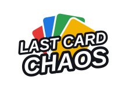
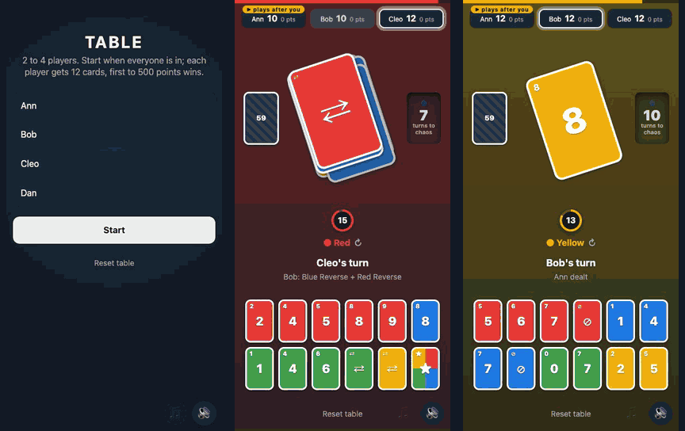

<p align="center">
  
</p>

<h1 align="center">Last Card Chaos</h1>

<p align="center">
  <b>Match the color. Survive the chaos. Empty your hand first.</b><br>
  A color-matching card game for 2 to 4 players, played in the browser on your phones. One person runs a tiny server; everyone else just opens a link.
</p>

<p align="center">
  <b>English</b> · <a href="README.tr.md">Türkçe</a>
</p>

<p align="center">
  
</p>

---

## Features

- Classic color-and-number matching with Skip, Reverse, +2, Wild and Wild +4 (108-card deck, 12 cards each)
- **Chaos wheel** every 10 turns: a player draws 4 to 10 cards, hands swap, a color gets banned or penalties double until the next wheel
- Stack +2 and +4 on each other, play several cards of the same kind at once
- 15-second turns with a countdown, "Last card!" calls you can get caught on, emoji reactions you can throw at friends
- Animations, sounds, background music and end-of-hand awards
- Turkish and English interface

## Quick start

You need [Node.js](https://nodejs.org) 18 or newer. Nothing else to install.

```bash
git clone https://github.com/serbestonline/last-card-chaos.git
cd last-card-chaos
npm start
```

The server prints the address to open. Everyone opens it on their phone, types a name and sits at the table; when everyone is in, someone presses **Start**.

### Language and port

The interface is in English by default. Whoever runs the server picks the language for everyone:

```bash
GAME_LANG=tr npm start
```

On Windows PowerShell:

```powershell
$env:GAME_LANG="tr"; npm start
```

The default port is 3333; change it with `PORT=4000 npm start`.

## Play together on the same Wi-Fi

If everyone is in the same place, nothing else is needed: phones on the same Wi-Fi open the `http://192.168.x.x:3333` address the server prints.

## Play online with friends (free Cloudflare tunnel)

If your friends are elsewhere, a free Cloudflare quick tunnel gives your local server a public `https://` link. No Cloudflare account is needed.

1. Install `cloudflared`:
   - macOS: `brew install cloudflared`
   - Windows: `winget install --id Cloudflare.cloudflared`
   - Linux: download the package for your system from [Cloudflare's downloads page](https://developers.cloudflare.com/cloudflare-one/connections/connect-networks/downloads/)
2. Start the game in one terminal: `npm start`
3. In a second terminal, open the tunnel:

   ```bash
   cloudflared tunnel --url http://localhost:3333
   ```

4. Cloudflare prints a link like `https://some-random-words.trycloudflare.com`. Send it to your friends; everyone (you too) plays from that link.

Good to know:

- The link changes every time you start the tunnel.
- Keep both terminals open and the computer awake while you play.
- Quick tunnels are free and meant for testing; Cloudflare gives no uptime guarantee.
- Anyone with the link can join the table or reset it, so share it only with the people you play with.
- The game state is saved to `masa.json` after every move, so restarting the server does not lose the hand in progress.

## Rules

Match the top card by **color**, **number** or **symbol**. Wilds can be played on anything and let you pick the next color. First player to empty their hand wins the hand and scores the cards left in the others' hands (numbers at face value, Skip/Reverse/+2 = 20, Wilds = 50). First to **500 points** wins the game.

House rules that make it chaotic:

- **Same kind together:** play several cards of the same number or symbol in one move; the last one sets the color. Two Skips skip two players.
- **Draw, then play:** after drawing, you may play any matching card from your hand; if nothing matches, your turn passes.
- **Stacking:** a +2 or +4 can be answered with another +2 or +4; the total keeps growing until someone draws it all.
- **Last card!:** press it when you are down to one or two cards. If you forget, another player can catch you and you draw 2.
- **15-second turns:** if time runs out, the game draws for you and passes.
- **Chaos wheel:** every 10 turns the wheel spins. Slices: each player "draws 4 to 10", "swap hands", "penalties ×2" and color bans. Bans and ×2 last until the next wheel; at least one color always stays free.
- Tap an opponent's box to throw 🍅 😂 💀 🔥 at them.

## Development

```bash
npm test
```

runs thousands of random hands and the rule checks. The code is three small files: `game.js` (rules), `server.js` (HTTP server, no dependencies) and `public/index.html` (the whole interface). Texts live in `lang.js` (server) and at the top of the script in `index.html` (interface).

## Credits and license

All sounds and the music are CC0 (public domain); see [CREDITS.md](CREDITS.md). The code is released under the [MIT License](LICENSE).
