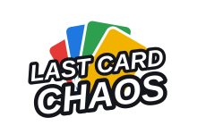
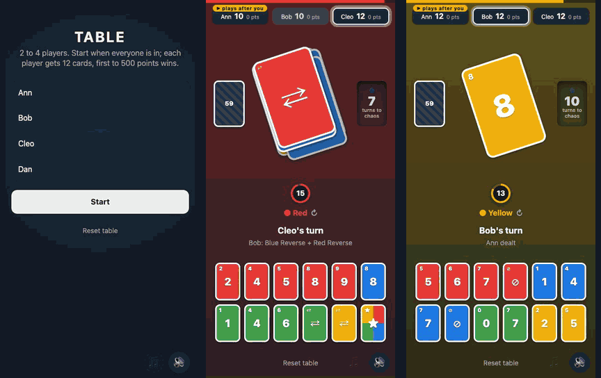

<p align="center">
  
</p>

<h1 align="center">Last Card Chaos</h1>

<p align="center">
  <b>Rengi eşle. Kaostan sağ çık. Elini ilk sen bitir.</b><br>
  Telefonlarda tarayıcıdan oynanan, 2 ile 4 kişilik bir renk eşleme kart oyunu. Bir kişi küçük bir sunucu çalıştırır, diğerleri yalnız bir link açar.
</p>

<p align="center">
  <a href="README.md">English</a> · <b>Türkçe</b>
</p>

<p align="center">
  
</p>

---

## Neler var

- Klasik renk ve sayı eşleme; Atla, Yön, +2, Joker ve Joker +4 (108 kart, herkese 12 kart)
- Her 10 sırada bir **kaos çarkı**: bir oyuncu 4 ile 10 arası kart çeker, eller el değiştirir, bir renk yasaklanır ya da cezalar bir sonraki çarka kadar ikiye katlanır
- +2 ve +4 birbirinin üstüne atılır; aynı türden kartlar birlikte atılır
- Geri sayımlı 15 saniyelik sıralar, unutursan yakalandığın "Tek!" çağrısı, arkadaşlarına fırlatabileceğin emojiler
- Animasyonlar, sesler, arka plan müziği ve el sonu ödülleri
- Türkçe ve İngilizce arayüz

## Hızlı başlangıç

[Node.js](https://nodejs.org) 18 ya da daha yenisi yeterli; başka bir şey kurmak gerekmez.

```bash
git clone https://github.com/serbestonline/last-card-chaos.git
cd last-card-chaos
GAME_LANG=tr npm start
```

Sunucu açılacak adresi yazar. Herkes onu telefonunda açar, adını yazıp masaya oturur; herkes gelince biri **Başlat**'a basar.

Arayüz varsayılan olarak İngilizcedir; `GAME_LANG=tr` ile herkes için Türkçe olur. Windows PowerShell'de: `$env:GAME_LANG="tr"; npm start`. Varsayılan port 3333; değiştirmek için `PORT=4000 npm start`.

## Aynı Wi-Fi'da oynamak

Herkes aynı yerdeyse başka bir şey gerekmez: aynı Wi-Fi'daki telefonlar sunucunun yazdığı `http://192.168.x.x:3333` adresini açar.

## Arkadaşlarla internetten oynamak (ücretsiz Cloudflare tüneli)

Arkadaşların başka yerdeyse Cloudflare'in ücretsiz hızlı tüneli, bilgisayarındaki sunucuya herkesin açabileceği bir `https://` linki verir. Cloudflare hesabı gerekmez.

1. `cloudflared`'ı kur:
   - macOS: `brew install cloudflared`
   - Windows: `winget install --id Cloudflare.cloudflared`
   - Linux: sistemine uygun paketi [Cloudflare'in indirme sayfasından](https://developers.cloudflare.com/cloudflare-one/connections/connect-networks/downloads/) indir
2. Bir terminalde oyunu başlat: `GAME_LANG=tr npm start`
3. İkinci bir terminalde tüneli aç:

   ```bash
   cloudflared tunnel --url http://localhost:3333
   ```

4. Cloudflare `https://rastgele-kelimeler.trycloudflare.com` gibi bir link yazar. Linki arkadaşlarına gönder; herkes (sen de) bu linkten oynar.

Bilmekte fayda var:

- Link, tüneli her açışında değişir.
- Oynarken iki terminal de açık, bilgisayar da uyanık kalmalı.
- Hızlı tüneller ücretsizdir ve deneme amaçlıdır; Cloudflare kesintisiz çalışma garantisi vermez.
- Linki bilen herkes masaya oturabilir ya da masayı sıfırlayabilir; linki yalnız birlikte oynadığın kişilerle paylaş.
- Oyun her hamleden sonra `masa.json` dosyasına kaydedilir; sunucuyu yeniden başlatmak süren eli silmez.

## Kurallar

Yerdeki karta **renk**, **sayı** ya da **sembolle** uyan bir kart at. Joker her şeyin üstüne atılır ve sonraki rengi sen seçersin. Elini ilk bitiren eli kazanır ve diğerlerinin elinde kalan kartlar kadar puan alır (sayılar kendi değeri, Atla/Yön/+2 20, jokerler 50). **500 puana** ilk ulaşan oyunu kazanır.

Oyunu kaotik yapan ev kuralları:

- **Aynı türden birlikte:** aynı sayı ya da sembolden birkaç kartı tek hamlede at; renk son kartın rengi olur. İki Atla iki kişiyi atlatır.
- **Çek, sonra at:** çektikten sonra elindeki uyan herhangi bir kartı atabilirsin; uyan yoksa sıra geçer.
- **Zincir:** +2 ya da +4'e başka bir +2 ya da +4 ile cevap verilir; ceza biri hepsini çekene kadar büyür.
- **Tek!:** bir ya da iki kartın kalınca bas. Unutursan başka bir oyuncu seni yakalar ve 2 kart çekersin.
- **15 saniyelik sıra:** süre dolarsa oyun senin yerine bir kart çeker ve sırayı geçirir.
- **Kaos çarkı:** her 10 sırada bir döner. Dilimler: her oyuncu için "4-10 kart çek", "eller değişir", "ceza ×2" ve renk yasakları. Yasak ve ×2 bir sonraki çarka kadar sürer; en az bir renk hep serbest kalır.
- Bir rakibin kutusuna dokunup ona 🍅 😂 💀 🔥 fırlatabilirsin.

## Geliştirme

`npm test` binlerce rastgele eli ve kural denemelerini çalıştırır. Kod üç küçük dosya: `game.js` (kurallar), `server.js` (bağımlılıksız HTTP sunucusu) ve `public/index.html` (bütün arayüz). Yazılar `lang.js`'te (sunucu) ve `index.html`'deki betiğin başında (arayüz) durur.

## Kaynaklar ve lisans

Bütün sesler ve müzik CC0 (kamu malı); ayrıntılar [CREDITS.md](CREDITS.md) dosyasında. Kod [MIT lisansıyla](LICENSE) paylaşılıyor.
